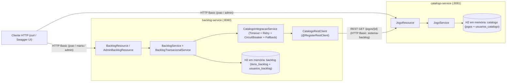
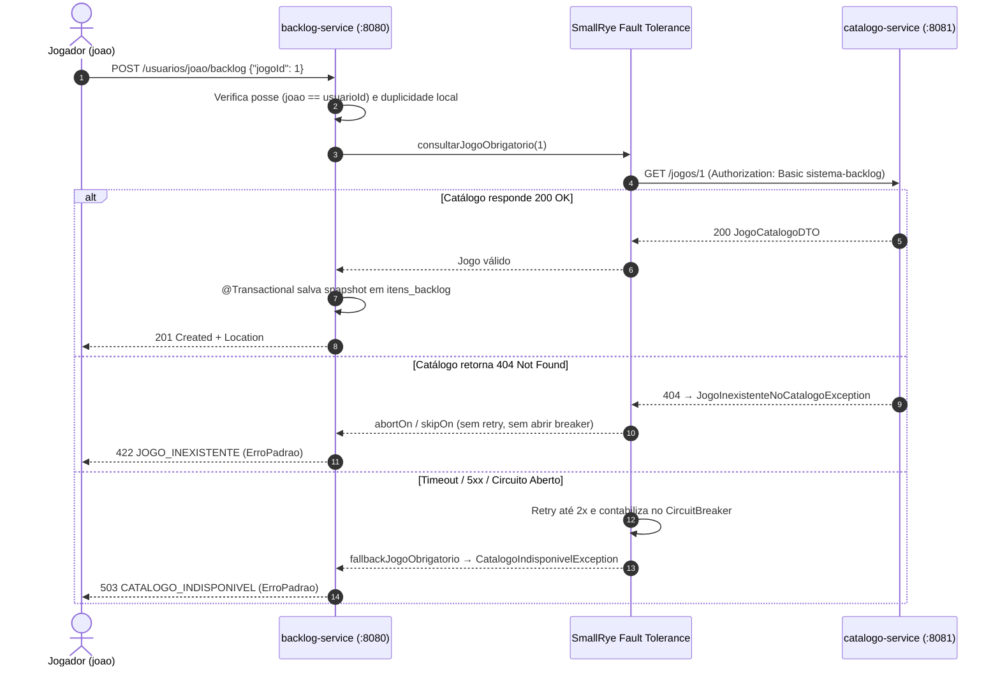

# Arquitetura — LetterGames Quarkus

## Visão Geral e Contextos Delimitados

O **LetterGames Quarkus** organiza o catálogo de jogos e o backlog pessoal de jogadores em dois microsserviços independentes em **Quarkus 3.15.7** e **Java 21**, cada qual com seu próprio banco H2 em memória e sem compartilhamento de base de dados.



| Serviço | Porta | Banco H2 | Responsabilidade |
|---|---:|---|---|
| `backlog-service` | `8080` | `jdbc:h2:mem:backlog` | Backlog por usuário, máquina de estados de transição, limite de jogos simultâneos (`JOGANDO`), resumo/estatísticas via Panache e integração síncrona resiliente. |
| `catalogo-service` | `8081` | `jdbc:h2:mem:catalogo` | CRUD e busca filtrada de jogos, unicidade por `(titulo, plataforma)` e validação de duração máxima configurável. |

---

## Fluxo Síncrono e Tolerância a Falhas (`backlog-service` → `catalogo-service`)

No porte do projeto **BE-JV-010** (Spring Boot) para o módulo **PE-JV-001** (Quarkus), a comunicação assíncrona (Kafka + Outbox) e o cache Redis foram removidos. O `backlog-service` mantém um *snapshot* local (`titulo` e `duracaoMediaHoras`) em `ItemBacklog`, mas valida obrigatoriamente a existência do jogo no `catalogo-service` antes de gravar, e enriquece detalhes sob demanda via `REST Client`.



### Política Diferenciada por Tipo de Operação e Justificativa Numérica

- **Idempotência no Retry:** O `@Retry` (`maxRetries = 2`, `delay = 200ms`, `jitter = 50ms`) envolve apenas a consulta `GET /jogos/{id}` (operação idempotente de leitura). Erros de negócio `404` (`JogoInexistenteNoCatalogoException`) e `4xx` (`CatalogoRequisicaoInvalidaException`), além de `CircuitBreakerOpenException`, estão em `abortOn`/`skipOn`, garantindo zero retries desnecessários.
- **Relação entre Retry e Circuit Breaker:** Como cada requisição falha executa no máximo `1 + 2 = 3` tentativas que passam pelo `@CircuitBreaker`, configuramos `requestVolumeThreshold = 6` (`failureRatio = 0.5`, `delay = 10000ms`, `successThreshold = 2`). Assim, uma única falha transitória não abre o disjuntor sozinha: são necessárias pelo menos duas requisições consecutivas esgotando retries (`6` chamadas falhas na janela) para abrir o circuito e proteger o `backlog-service`.
- **Fallback coerente com o impacto:**
  - Na escrita (`POST /usuarios/{usuarioId}/backlog`), o fallback `fallbackJogoObrigatorio` **recusa** a criação com `503 CATALOGO_INDISPONIVEL`, pois criar um item sem validar o `jogoId` quebraria a integridade referencial entre contextos.
  - Na leitura enriquecida (`GET /usuarios/{usuarioId}/backlog/{itemId}/detalhes`), o fallback `fallbackDetalhesComSnapshot` responde **`200 OK` degradado** (`catalogoDisponivel = false`) utilizando o snapshot local (`titulo` e `duracaoMediaHoras`) e informando um `aviso` explícito ao consumidor.
- **Separação de Transação:** `BacklogService.adicionar` consulta o catálogo **fora** de `@Transactional` e só aciona `BacklogTransacionalService.salvarNovoItem` após receber o `JogoCatalogoDTO`, evitando prender conexões do pool Hikari/Agroal durante timeouts ou backoff de retries.

---

## Contrato REST e Corpo Único de Erros

Todos os erros de validação (Bean Validation), JSON malformado, domínio e segurança (`401`/`403`) devolvem o mesmo envelope `ErroPadrao`:

```json
{
  "status": 422,
  "codigo": "TRANSICAO_INVALIDA",
  "mensagem": "Transição inválida: QUERO_JOGAR -> ZERADO. A partir de QUERO_JOGAR só é permitido: [JOGANDO, ABANDONADO]",
  "caminho": "/usuarios/joao/backlog/1",
  "timestamp": "2026-11-17T23:10:00Z",
  "detalhes": []
}
```

### Mapa de Rotas e Papéis

| Serviço | Método e Rota | Papéis / Regra | Status HTTP |
|---|---|---|---|
| `catalogo-service` | `POST /jogos` | `ADMIN` | `201`, `400`, `401`, `403`, `409`, `422` |
| `catalogo-service` | `GET /jogos` · `GET /jogos/{id}` | `JOGADOR`, `ADMIN` | `200`, `401`, `404` |
| `catalogo-service` | `PUT /jogos/{id}` · `DELETE /jogos/{id}` | `ADMIN` | `200`/`204`, `400`, `401`, `403`, `404`, `409`, `422` |
| `backlog-service` | `POST /usuarios/{u}/backlog` | `JOGADOR` + `principal == {u}` | `201`, `400`, `401`, `403`, `409`, `422`, `502`, `503` |
| `backlog-service` | `GET /usuarios/{u}/backlog` · `/resumo` · `/{itemId}` · `/{itemId}/detalhes` | (`JOGADOR` + `principal == {u}`) ou `ADMIN` | `200`, `400`, `401`, `403`, `404` |
| `backlog-service` | `PATCH /usuarios/{u}/backlog/{itemId}` · `DELETE ...` | `JOGADOR` + `principal == {u}` | `200`/`204`, `400`, `401`, `403`, `404`, `422` |
| `backlog-service` | `GET /admin/backlogs/estatisticas` | `ADMIN` | `200`, `401`, `403` |
| Ambos | `GET /q/health/live` · `/q/health/ready` · `/q/metrics` · `/q/openapi` | Público (`proactive=false`) | `200` |

---

## Decisões de Persistência Panache e Segurança

1. **`PanacheRepository` em vez de Active Record:** Escolhemos `JogoRepository` e `ItemBacklogRepository` (`implements PanacheRepository<...>`) para manter as entidades JPA desacopladas de estado estático, facilitar o isolamento entre domínio e consultas JPQL/agregações e seguir a transição idiomática de quem vem do Spring Data JPA.
2. **Geração de ID `GenerationType.IDENTITY`:** Optamos por `IDENTITY` nas entidades (`Jogo`, `ItemBacklog`, `UsuarioCatalogo`, `UsuarioBacklog`) por ser nativa e previsível no H2 em memória sem exigir tabela ou sequence global compartilhada entre entidades distintas.
3. **Autenticação JPA com BCrypt + Princípio do Menor Privilégio + Regra de Posse:**
   - As senhas ficam gravadas em banco via `BcryptUtil.bcryptHash(...)` e validadas pelo `quarkus-security-jpa`.
   - A conta técnica `sistema-backlog` usada pelo `backlog-service` para consultar o `catalogo-service` possui apenas o papel `JOGADOR` (somente leitura em `/jogos/{id}`), nunca `ADMIN`.
   - `AutorizadorBacklog` impõe que um `JOGADOR` só manipula e lê `/usuarios/{usuarioId}/backlog/**` quando `usuarioId` corresponde ao usuário autenticado; `ADMIN` pode consultar backlogs e `/admin/backlogs/estatisticas`, mas não pode alterar itens pessoais de terceiros.
